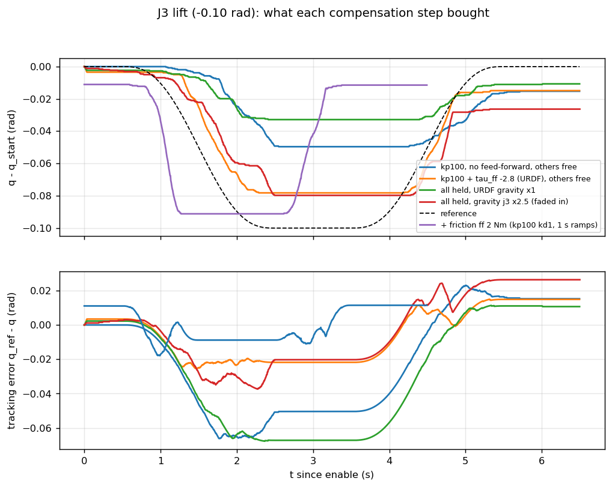
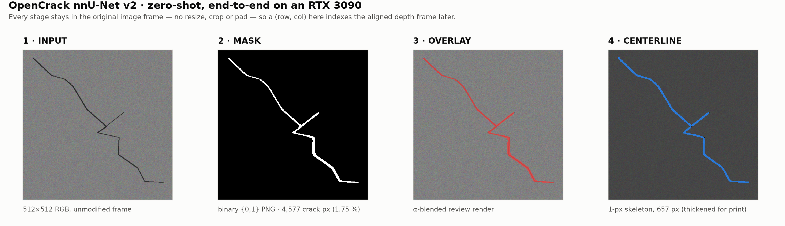

# reBot B601-DM bridge crack-inspection arm

My Fort Lewis College senior-design project (Sep 2026 to present, advisor Dr. Yiyan Li): a reBot B601-DM
arm (six joints plus a gripper) with a wrist-mounted Intel RealSense D405 camera, being adapted to find and
trace cracks in concrete. We are a two-person team. My teammate is building a second arm from scratch; I am
the only person working on this reBot arm.

## What I built on the arm

All results below are from operator-attended runs on the physical arm. Full write-up, raw logs and figures:
[`docs/motion/CONTROLLER_TUNING.md`](docs/motion/CONTROLLER_TUNING.md).

- **Motor bring-up and control loop.** All seven Damiao motors run over the CAN bus in MIT mode. A 200 Hz host
  loop streams each motor its setpoint, stiffness and damping gains, and feed-forward torque
  ([`demo_move.py`](evidence/operator/controller-tuning-2026-10/code/demo_move.py),
  [`first_move_j1.py`](evidence/operator/controller-tuning-2026-10/code/first_move_j1.py)).
- **Kinematics and planning.** A 6-row geometric Jacobian, mapping joint velocities to the tool's linear and
  angular velocity (`geometric_jacobian` in
  [`presentation/demo/arm_kinematics.py`](presentation/demo/arm_kinematics.py), used by the offline demo
  planner); the damped-least-squares IK and path follower that generate the trajectories run on the arm
  ([`src/crackvision/arm_ik.py`](src/crackvision/arm_ik.py)); and a minimum-jerk planner (`min_jerk` in
  [`demo_move.py`](evidence/operator/controller-tuning-2026-10/code/demo_move.py), derivation in
  [write-up §3](docs/motion/CONTROLLER_TUNING.md#3-reference-trajectories)).
- **Simulation before hardware.** Motion scripts and their abort checks are tested first against a simulated
  motor bus ([`fakebus.py`](evidence/operator/controller-tuning-2026-10/code/fakebus.py), write-up §10), and
  trajectories are rehearsed in simulation (`run-trajectory.sh --rehearse`) before they run on the arm
  ([`docs/motion/FIRST_GUARDED_RUN.md`](docs/motion/FIRST_GUARDED_RUN.md)). Since 2026-10-21, every motor command passes
  [`arm_guard`](docs/motion/ARM_GUARD.md), a last-line safety filter.
- **Measured the real gravity load.** The elbow kept falling short of its target. A slow torque test on the
  elbow (J3) found 6.6 N·m of gravity load, against 2.7 N·m computed from the vendor URDF
  ([write-up §6](docs/motion/CONTROLLER_TUNING.md#6-identification-of-the-real-loads)).
- **Gravity and friction feed-forward plus retuned gains** cut the holding error on loaded joints from
  0.04–0.05 rad to 0.005 rad or less, measured in post-tuning single-joint holds after a 0.10 rad move
  (41 logged runs: 28 completed; aborted, refused and read-only runs are logged too). With several joints moving
  at once the error is larger: in the first multi-joint move J3's hold error grew to 0.0096 rad, because its
  gravity load changes as J2 moves, and a 52 s seven-joint demo tracked every joint within about 0.025 rad
  ([write-up §9](docs/motion/CONTROLLER_TUNING.md#9-multi-joint-moves-and-the-demos)).

Videos of the physical arm:
[commanded trajectory](docs/media/trajectory_live.mp4) and
[kinematics on hardware](docs/media/kinematics_live.mp4)
(also on the [project page](https://janga786.github.io/projects/rebot-crack-inspection/)).

<p align="center">
  
</p>

**Scope.** These were operator-attended runs, not commissioning. Joint limits are still the vendor URDF values,
the only e-stop during the tuning runs was the 24 V supply switch, and the camera-to-gripper transform is a
nominal CAD value until hand-eye calibration is done.

## Crack-segmentation pipeline

The perception pipeline turns an RGB image of a concrete or masonry surface into a binary crack mask and a
one-pixel crack skeleton. It uses the publicly released OpenCrack nnU-Net weights as released, with no training
of my own. Phase 1 asked one question: can a zero-shot, publicly released crack-segmentation model do useful
work on this hardware and imagery, or does the project need its own labelling and training? Phase 1 left out
depth projection, hand-eye calibration, robot integration and fine-tuning, each recorded as an ADR in
[`docs/adr/`](docs/adr). Phase 2 has since started adding depth, frames and motion planning
([ADR-011](docs/adr/011-phase2-full-pipeline-scope.md)); any fine-tuning waits on an evaluation on real imagery.

<p align="center">
  
</p>

**Status.** The model runs on the real D405 (live view about 17 mask updates a second). On 2026-10-30 the arm
completed its first crack search on a printed crack: every stop that saw the crack accepted it, but the scan
step aborted when the camera dropped off USB, so no crack was traced
([evidence](evidence/operator/first-crack-run-2026-10-30/README.md)). No accuracy number on real D405 imagery is
claimed yet ([`docs/D405_TEST_PLAN.md`](docs/D405_TEST_PLAN.md)), and the model over-fires on masonry joints
and similar crack-like texture.

## Quickstart

1. Put images in `data/input_originals/`
2. Run `./run_test.sh`
3. Open `data/comparisons/`

(Never run scripts against a bare `python` — ROS Humble leaks a Python 3.10 `PYTHONPATH` into any
interpreter on this box, including this project's 3.11 env. Always go through `./env.sh` or
`./run_test.sh`, which wrap it for you. See [`docs/RUNBOOK.md`](docs/RUNBOOK.md) for full setup from
a clean clone.)

## What this does

```
   RGB image                binary mask              1-pixel skeleton
data/input_originals/  ->  OpenCrack nnU-Net v2  ->  {0,1} mask  ->  overlay / comparison
                              (2D, fold 0)          data/predictions/    data/overlays/
                                                                          data/comparisons/
                                                            |
                                                            v
                                              remove_small_objects + skeletonize
                                                            |
                                                            v
                                                data/skeletons/ (1-px {0,255} raster)
```

Every stage preserves the frame invariant: a `(row, col)` in the mask is the same `(row, col)` in
the original image — nothing resizes, crops or pads (`docs/INTERFACES.md` §0.5). That invariant is
what later lets a `(row, col)` be looked up in an aligned depth frame to build a 3D robot
trajectory — the next phase, not this one.

## Current scope / Not yet implemented

Phase 1 (`task_cards/TC-001`…`TC-016`, this repository's original deliverable) is RGB-in,
mask/skeleton-out, on files on disk. It deliberately does **not** include:

- **Depth projection or camera calibration** — RGB is consumed first; depth comes later
  (`docs/adr/002-rgb-first-depth-later.md`).
- **Ordered path extraction from the skeleton** — the 1-pixel raster is this phase's perception
  endpoint; turning it into an ordered traversal path is out of scope here
  (`docs/adr/008-mask-to-skeleton-endpoint.md`).
- **Robot control, hand-eye calibration or ROS 2 integration**
  (`docs/adr/009-robot-ros-integration-deferred.md`).
- **Any model training or fine-tuning** — the OpenCrack weights are used exactly as released
  (`docs/adr/010-no-training-this-phase.md`).
- **A quantitative zero-shot accuracy claim on real D405 imagery** — the D405 is now connected
  (status above), but no measured accuracy on real imagery is claimed yet; see
  [`docs/D405_TEST_PLAN.md`](docs/D405_TEST_PLAN.md) for the planned evaluation and
  `tools/dataset_manifest.py` for the manifest tooling that will back it.

A later phase of this same repository (`docs/adr/011-phase2-full-pipeline-scope.md`,
`docs/adr/012-frames-and-conventions.md`) has since started lifting these deferrals in dependency
order (depth backprojection, frame conventions, robot motion planning); that work lives alongside
this pipeline but is outside what Phase 1 / `TC-016` documents. `docs/ARCHITECTURE.md` and
`docs/TECHNICAL_APPROACH.md` are the entry points if you want the fuller picture.

## Setup from scratch

See [`docs/RUNBOOK.md`](docs/RUNBOOK.md) for numbered, copy-pasteable steps from a clean clone to a
first result, plus a troubleshooting table for the failure modes newcomers actually hit.

## Commands

Every CLI accepts the common flags documented in `docs/INTERFACES.md` §0.3
(`--root`, `--config`, `-v/--verbose`, `-q/--quiet`, `--dry-run`, `--skip-existing`) and exits
0/1/2/3 per `docs/INTERFACES.md` §0.2. Always invoke through `./env.sh`.

| Command | Purpose |
|---|---|
| `./run_test.sh` | One-command pipeline: `check_env` → `prepare_inputs` → `inference` → `visualize` → `skeleton` → `summarize_run`. |
| `./env.sh python scripts/check_env.py` | Level-1 environment check (Python/CUDA/nnU-Net/model files). |
| `./env.sh python scripts/fetch_model.py` | Downloads the OpenCrack nnU-Net weights and writes `config/model_manifest.json`. |
| `./env.sh python scripts/verify_model.py` | Verifies the on-disk model tree against the manifest (`--check-hashes` for full sha256 verification). |
| `./env.sh python scripts/smoke_test.py` | Level-2 synthetic end-to-end smoke test — real checkpoint, synthetic images, no user data needed. |
| `./env.sh python -m crackvision.prepare_inputs` | Converts arbitrary imagery in `data/input_originals/` to 3-channel RGB PNGs and writes `data/case_map.json`. |
| `./env.sh python -m crackvision.inference` | Runs `nnUNetv2_predict_from_modelfolder` over `data/nnunet_input/`. |
| `./env.sh python -m crackvision.visualize` | Renders `data/predictions/` into human-viewable masks/overlays/comparisons. |
| `./env.sh python -m crackvision.skeleton` | Cleans and skeletonizes a mask to a 1-pixel centerline in `data/skeletons/`. |
| `./env.sh python scripts/summarize_run.py` | Prints the per-case summary table `run_test.sh` uses at the end of a run. |
| `./env.sh python scripts/check_realsense.py` | Verifies the RealSense software stack; works with no camera attached. |
| `./env.sh python scripts/camera.py check\|snap\|live\|record` | The physical D405: first-connection evidence, capture + full crack pipeline, live model view in a browser, lossless recording ([docs/camera/D405_SETUP.md](docs/camera/D405_SETUP.md)). |
| `./env.sh python scripts/capture_d405.py` | Captures depth-aligned RGB + raw depth from a D405 (or `--synthetic` with no hardware). |
| `./env.sh python tools/dataset_manifest.py` | `init`/`scan`/`validate`/`summary` for the D405 evaluation manifest (`docs/D405_TEST_PLAN.md`). |
| `./env.sh pytest tests/ -v` | The unit/integration/contract test suite; no GPU or camera needed (725 passed, 26 skipped on a CPU-only machine, 2026-11-09, about two minutes). |

## Project layout

```
src/crackvision/       prepare_inputs · inference · visualize · skeleton · naming · config · paths
                        (plus realsense_capture, recording, geometry, skeleton_graph — later phases)
scripts/                check_env · fetch_model · verify_model · smoke_test · check_realsense ·
                        capture_d405 · summarize_run
tools/                  dataset_manifest.py — D405 evaluation-manifest tooling
tests/                  unit, integration, and contract tests (no GPU or camera required)
docs/                   ARCHITECTURE · INTERFACES · RISKS · VALIDATION_PLAN · D405_TEST_PLAN ·
                        TECHNICAL_APPROACH · MACHINE_STATE · RUNBOOK · ENVIRONMENT_SNAPSHOT ·
                        LICENSE-NOTICES · COMPLETION_LOG · REVIEW_LOG · adr/
task_cards/             the 16 Phase-1 specs this pipeline was built from, plus the (frozen) status
                        board; later work is specified as cards under `plan/`
presentation/           slide deck, figures, and the vision → path → arm demo
config/project.yaml     every tunable; no magic numbers in source
config/model_manifest.json   the pinned model download: repo id, revision, per-file sha256
packages/arm_guard/      last-line motor-command safety filter (docs/motion/ARM_GUARD.md)
env.sh                  the launcher — scrubs ROS off the interpreter path, then runs your command
run_test.sh             the one-command orchestrator (see Commands, above)
```

## Status log

The dated project log, newest phase first. Weekly write-ups are in [`docs/progress/`](docs/progress).

> **Current status (Phase 2, updated 2026-10-22).**
> - Phase 1 (above) is complete.
> - Phase 2 ([ADR-011](docs/adr/011-phase2-full-pipeline-scope.md)) extends it to ordered crack paths,
>   depth → 3D, eye-in-hand hand-eye calibration, MoveIt planning and gated commissioning. The work is
>   tracked as cards under [`plan/`](plan) and weekly write-ups in [`docs/progress/`](docs/progress).
> - The end-of-arm model is in [ADR-014](docs/adr/014-end-effector-frames-and-task-phases.md): a wrist D405
>   on Seeed's stock mount, a `tool_tip` distinct from the grasp-centre `gripper_tcp`, and separate
>   view and trace phases.
> - **Physical arm (2026-10-14 / 10-17): first powered runs.** All 7 motors over CAN at 200 Hz in MIT mode,
>   gravity and friction feed-forward identified on hardware (elbow gravity load measured at 6.6 N·m vs
>   2.7 N·m in the URDF), and loaded-joint hold error cut from 0.04–0.05 rad to ≤ 0.005 rad in
>   post-tuning holds, across a 41-run logged campaign (28 completed; aborted, refused, and read-only
>   checks logged too). A 52 s seven-joint demo tracked every joint within about 0.025 rad. Write-up and raw logs:
>   [`docs/motion/CONTROLLER_TUNING.md`](docs/motion/CONTROLLER_TUNING.md). These were operator-attended
>   runs, not commissioning. Video of the physical arm under commanded motion:
>   [`docs/media/trajectory_live.mp4`](docs/media/trajectory_live.mp4) and
>   [`docs/media/kinematics_live.mp4`](docs/media/kinematics_live.mp4).
> - Still nominal until measured: camera extrinsic, tool tip, workcell, and joint limits (vendor URDF values).
>   Pending: D405 hand-eye calibration and gated commissioning (MOT-05 / MOT-09).
> - **First guarded trajectory on the physical arm (2026-10-22):** shown in simulation first, then run on the
>   operator's go. It completed with tracking within 0.023 rad and no guard fault. A visible 3.3 Hz shoulder/elbow
>   wobble was traced to low damping, and kd 4 cut it about in half
>   ([evidence](evidence/operator/first-guarded-run-2026-10-22/README.md),
>   [session summary](docs/SESSION_2026-10-21_22.md)).
> - **Arm safety (2026-10-21):** every motor command now passes [`arm_guard`](docs/motion/ARM_GUARD.md), a
>   last-line filter in front of `motorbridge`, with a startup position check. A trajectory runner on the operator's
>   controller was rehearsed ahead of the first guarded run, which completed on 2026-10-22 (bullet above):
>   [`FIRST_GUARDED_RUN.md`](docs/motion/FIRST_GUARDED_RUN.md).
>   Remaining steps (CAN watchdog, measured joint limits) are in [`TODO.md`](TODO.md).
> - **Camera (2026-10-22): the real D405 is connected and running the model.** `scripts/camera.py check` (first
>   connection + evidence), `record --video` (30 fps, lossless + MP4), `snap` (capture -> full crack pipeline ->
>   overlays, mm scale from depth) and `live` (30 fps video in a browser, crack mask from the model 17 times a second). Setup:
>   [`docs/camera/D405_SETUP.md`](docs/camera/D405_SETUP.md); first-connection report:
>   [`docs/camera/D405_FIRST_CONNECTION.md`](docs/camera/D405_FIRST_CONNECTION.md).

## Results interpretation

- **Predictions in `data/predictions/` are `{0,1}`-valued uint8 PNGs and LOOK SOLID BLACK. This is
  correct, not a bug.** `NaturalImage2DIO.write_seg` writes raw label values; at any normal display
  gamma, `{0,1}` is indistinguishable from black. Do not rescale these files.
- Use `data/overlays/` (crack highlighted on the original) and `data/comparisons/`
  (original | mask | overlay, side by side) to actually look at a result.
- The model over-fires on masonry/tile joints, mortar lines and other crack-like texture — see its
  own model card's Limitations section (cached locally at `models/opencrack-nnunet/README.md` after
  `fetch_model.py` runs).

## Attribution

Fort Lewis College senior-design project (Robotic Arm Bridge Repair Team), advised by Dr. Yiyan Li. We are a
two-person team: my teammate is building a second arm from scratch, and I am the only person working on this
reBot arm.

Third-party work this project builds on:


- **OpenCrack nnU-Net** — `fadeevla/opencrack-nnunet`, CC-BY-4.0.
- **nnU-Net v2** — Isensee, F. et al., *nnU-Net: a self-configuring method for deep learning-based
  biomedical image segmentation*, Nature Methods 18, 203–211 (2021). Apache-2.0.

- **reBot B601-DM vendor URDF** — the copy in [`presentation/sim/`](presentation/sim/reBot_B601_DM_with_gripper.urdf)
  comes from the `rebotarm_bringup` package of the arm's ROS 2 controller; the motors are driven through the
  third-party `motorbridge` library (not included here).

Full third-party notices and citations: [`docs/LICENSE-NOTICES.md`](docs/LICENSE-NOTICES.md).

## License

This project's own code and documentation are released under the MIT License ([`LICENSE`](LICENSE)).
Third-party models, libraries and the vendor URDF keep their own licences, listed in
[`docs/LICENSE-NOTICES.md`](docs/LICENSE-NOTICES.md).

Crack imagery in `presentation/assets/` is synthetic, generated by this project's own smoke test.

## Documentation index

**Start here:** [`docs/RUNBOOK.md`](docs/RUNBOOK.md) (setup) ·
[`docs/ARCHITECTURE.md`](docs/ARCHITECTURE.md) (design) ·
[`docs/TECHNICAL_APPROACH.md`](docs/TECHNICAL_APPROACH.md) (how it works, written for the deck).

**Planning and contracts**
- [`docs/ARCHITECTURE.md`](docs/ARCHITECTURE.md) — component boundaries, pipeline, environment/GPU
  strategy, known risks.
- [`docs/INTERFACES.md`](docs/INTERFACES.md) — normative I/O contracts every CLI/module must satisfy.
- [`docs/RISKS.md`](docs/RISKS.md) — risk register (R-01…, including the `{0,1}` prediction trap).
- [`docs/VALIDATION_PLAN.md`](docs/VALIDATION_PLAN.md) — the three testing levels this project uses.
- [`docs/D405_TEST_PLAN.md`](docs/D405_TEST_PLAN.md) — the planned zero-shot evaluation design.
- [`docs/MACHINE_STATE.md`](docs/MACHINE_STATE.md) — target machine inventory (OS/CPU/GPU) as
  directly probed.
- [`docs/adr/`](docs/adr) — every deferral/design decision, numbered (`000`…`021`).

**Reproducibility**
- [`docs/RUNBOOK.md`](docs/RUNBOOK.md) — from a clean clone to a first result, plus troubleshooting.
- [`docs/ENVIRONMENT_SNAPSHOT.md`](docs/ENVIRONMENT_SNAPSHOT.md) — frozen dependency/version record.
- [`docs/host/REPRO_AUDIT.md`](docs/host/REPRO_AUDIT.md) — fresh-clone path-relocatability and
  from-lock-file reproducibility audit (`scripts/audit_fresh_clone.sh`), with RUNBOOK findings.
- [`docs/LICENSE-NOTICES.md`](docs/LICENSE-NOTICES.md) — third-party model/library attribution.

**History**
- [`docs/COMPLETION_LOG.md`](docs/COMPLETION_LOG.md) — append-only build history (evidence per card).
- [`docs/REVIEW_LOG.md`](docs/REVIEW_LOG.md) — append-only review history (acceptance checks re-run per card).
- [`task_cards/TASK_INDEX.md`](task_cards/TASK_INDEX.md) — the original Phase-1 dependency map and
  status board (frozen as history; later cards are under [`plan/cards/`](plan/cards)).
- `task_cards/TC-001-*.md` through `TC-016-*.md` — the individual Phase-1 task specs this pipeline was
  built from.

**Arm, camera and later-phase docs**
- [`docs/motion/CONTROLLER_TUNING.md`](docs/motion/CONTROLLER_TUNING.md) — controller tuning of the physical
  arm: control law, gravity identification, gain sweeps, demos, raw logs.
- [`docs/host/HOST_MANIFEST.md`](docs/host/HOST_MANIFEST.md) — host version pinning and drift checks.
- [`docs/motion/ROBOT_MODEL.md`](docs/motion/ROBOT_MODEL.md) — reBot B601-DM model reconciliation.
- [`docs/motion/ROS_WORKSPACE.md`](docs/motion/ROS_WORKSPACE.md) — ROS 2 overlay workspace + headless
  MoveIt mock planning.
- [`docs/camera/D405_SETUP.md`](docs/camera/D405_SETUP.md) — the D405: hardware facts, cable and port, firmware, and
  running the crack model on the live camera (`scripts/camera.py`)
- [`docs/motion/FIRST_GUARDED_RUN.md`](docs/motion/FIRST_GUARDED_RUN.md) — operator runbook: the first trajectory on the
  powered arm with arm_guard in front of it
- [`docs/motion/ARM_GUARD.md`](docs/motion/ARM_GUARD.md) — the last-line motor-command filter; open items in
  [`TODO.md`](TODO.md).
- [`docs/progress/README.md`](docs/progress/README.md) — the project's running progress log.

**Presentation**
- [`presentation/index.html`](presentation/index.html) — a self-contained slide deck (arrow keys to
  navigate, `Ctrl-P` to export a PDF); [`presentation/SLIDES.md`](presentation/SLIDES.md) carries the
  same content as speaker notes, and every figure is regenerated from committed artefacts by
  `presentation/tools/make_figures.py`.
