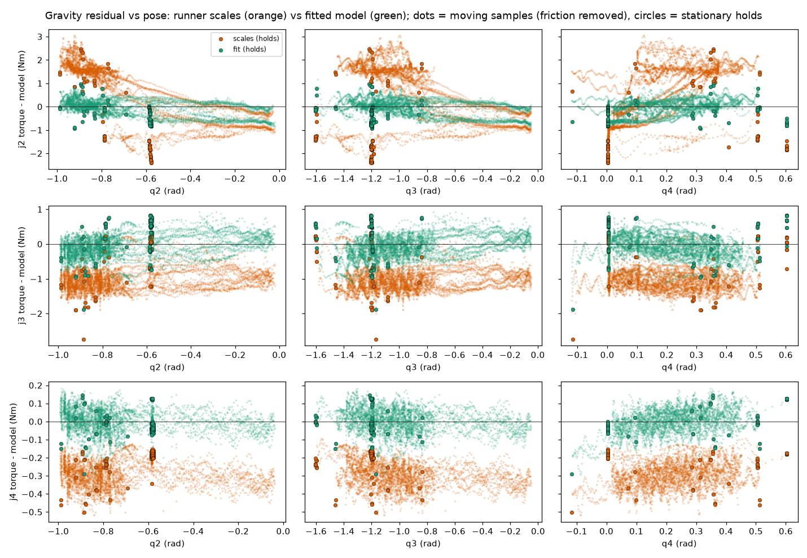

# Gravity model for the B601-DM: a fitted, pose-dependent feed-forward (2026-10-29)

Plan: [GRAVITY_MODEL_PLAN.md](GRAVITY_MODEL_PLAN.md). Background: [CONTROLLER_TUNING.md](CONTROLLER_TUNING.md) §5-7
(the URDF model, the identified scales, the feed-forward), the powered show runs
([evidence/operator/powered-show-runs-2026-10-23_25](../../evidence/operator/powered-show-runs-2026-10-23_25/README.md)).

**Status: built and tested on the workstation only. Nothing has run on the arm.** The model is used only when the
operator passes `--gravity-model config/robot/gravity_model.yaml` for one run; without it the runner behaves exactly
as before (byte-identical command stream, proven below). **The crack workspace is extrapolated** (`extrapolated: true`
in the yaml) until the survey in §7 has been run on the arm and the model refitted.

| What | Where |
|---|---|
| Fit tool | [`tools/fit_gravity_model.py`](../../tools/fit_gravity_model.py) (+ the physics in [`src/crackvision/gravity_model.py`](../../src/crackvision/gravity_model.py)) |
| Fitted model | [`config/robot/gravity_model.yaml`](../../config/robot/gravity_model.yaml) (`crackvision.gravity_model/1`) |
| Residual plot | [`figures/gravity_model_residuals.png`](figures/gravity_model_residuals.png) |
| Runner option | `~/rebot_setup/demo_move.py --gravity-model FILE` (version 2026-10-29.1; snapshot [evidence/operator/rebot_setup_runner_2026-10-29](../../evidence/operator/rebot_setup_runner_2026-10-29/README.md)) |
| Survey | [`tools/make_gravity_survey.py`](../../tools/make_gravity_survey.py) → `~/rebot_setup/trajectories/gravity_survey.json` |
| Re-scoring / A/B | `tools/analyze_run_gains.py RUN.csv --gravity-model FILE`, `--compare A.csv B.csv` |
| Tests | `tests/test_fit_gravity_model.py`, `tests/test_make_gravity_survey.py`, `tests/test_analyze_run_gains.py`, `~/rebot_setup/test_demo_move.py` (`GravityModelFlag`) |

## 1. The headline numbers

- **Leave-one-run-out over the 7 show runs** (the model never saw the run it is scored on), what the P/D terms had to
  supply along the path, mean over the runs of |mean| / rms, Nm:

  | joint | runner today (URDF x 0.6/2.5/2.5) | today + 2026-10-25 `--ff-bias` | **fitted model** |
  |---|---|---|---|
  | J2 | 1.07 / 1.39 (10.7 / 13.9 mrad) | 0.31 / 0.92 (3.1 / 9.2 mrad) | **0.09 / 0.41 (0.9 / 4.1 mrad)** |
  | J3 | 0.97 / 1.19 (12.2 / 14.8 mrad) | 0.39 / 0.74 (4.9 / 9.3 mrad) | **0.17 / 0.74 (2.2 / 9.3 mrad)** |
  | J4 | 0.29 / 0.43 (7.3 / 10.9 mrad) | 0.10 / 0.33 (2.5 / 8.2 mrad) | **0.05 / 0.33 (1.3 / 8.1 mrad)** |

  The steady sag (the mean) drops to 1-2 mrad on every joint; the predicted mean sag on the three held-out hearts is
  ≤ 2.7 mrad per joint. The rms of J3 and J4 does not drop the way J2's does: J3's is dominated by the rows where the
  forearm sits on its rest at the fold (contact, §5.3) and J4's by its speed-dependent error (a gain/friction matter,
  §5.4). Without the rest-pose rows, the fit beats today + bias on rms on **every** held-out run and joint.
- **The real arm is about three times heavier distally than the URDF**, and that does not stay a constant scale:
  J2 changes sign across the show workspace (+1.75 Nm at the heart's start pose, where the URDF says 0.03 and today's
  feed-forward 0.02). The fit carries ~1.96 kg of extra equivalent mass on link3…gripper + the 0.1 kg camera.
- **The crack workspace needs ~4x today's J2 feed-forward if the model extrapolates correctly**: J2 holding torque
  up to 9.9 Nm on the newest demo trace (today: 2.2 Nm). If that is right, **today's runner would let J2 sag up to
  77 mrad there (62 mrad on the search sweep), tipping the arm forward toward the table**, against a 100 mrad tracking
  abort. This is the main reason to run the survey before the crack trace (§8).
- With the model, J3 near the fold needs 8.2-8.3 Nm of gravity + the runner's 2 Nm Coulomb term = 10.2-10.3 Nm, over
  the 10 Nm feed-forward cap (the real arm measured 9.4-10.1 Nm lifting there); the runner therefore trims the Coulomb
  term to stay 0.05 Nm inside the cap (§6). Gravity alone over a cap is still refused.

## 2. The model (physics)

`crackvision.gravity_model` re-implements the runner's `gravity.py` (same URDF, same FK, verified to 1e-15 Nm
against it, `test_vectorised_gravity_matches_the_runners_gravity_py`) in numpy over many poses. For a point mass $m$
at local position $\mathbf r$ on link $L$ (world rotation $R_L$, origin $\mathbf t_L$) and a joint $i$ proximal to
$L$ (world axis $\mathbf a_i$ through $\mathbf p_i$):

$$
G_i = -\mathbf a_i\cdot\big((R_L\mathbf r + \mathbf t_L - \mathbf p_i)\times m\mathbf g\big)
    = -\,m\,(\mathbf t_L - \mathbf p_i)\cdot(\mathbf g\times\mathbf a_i)\;-\;(m\mathbf r)\cdot R_L^{\mathsf T}(\mathbf g\times\mathbf a_i)
$$

so the holding torque is **linear in each extra body's mass $m$ and first moment $m\mathbf r$**. The URDF's own
masses are the fixed part. Unknowns (21): a free extra body (m, m·rx, m·ry, m·rz) on each of link3, link4, link5,
link6 and gripper_link, plus the D405 + stock mount as a body of unknown mass at its CAD centre in gripper_link
(−0.0887, 0, −0.0627) m (housing 0.06 kg + mount 0.04 kg, placed from `end_effector.yaml`). Ridge prior: zero extra
mass (sd 0.5 kg per body, 0.05 kg·m per first-moment component), the camera at 0.10 ± 0.05 kg.

A model fitted this way extrapolates by geometry (the lever arms of the bodies change with the pose), not by the
shape of a curve; a lookup or a polynomial fitted on the logs would be pure extrapolation where the crack work
happens. The masses are in the motor's torque units: if a motor's torque constant were off, the masses would be
scaled, but the feed-forward (commanded in the same units the motor reports) would still be right.

## 3. Data and selection

All runs with every joint logged (`~/rebot_setup/runs`, 200 Hz): the 7 show runs of 2026-10-23/25 (figure-8 x2,
heart x3, showreel, box), demo_show x10 and demo_wave (2026-10-17..21), smoke_raise x2 (2026-10-22). The single-joint
`first_move_*` sweeps have a different log format and sit at the fold only; they are not used.

- **Holds** (stationary windows): measured |v| < 0.01 rad/s (50 ms average) and |v_ref| < 0.005 rad/s on J2-J4 for
  ≥ 0.2 s; > 1 s after enable (the fade-in); not in a guard hold or park; not on the forearm's rest (J3 > −0.05 rad,
  §5.3). One observation per joint per window (median torque) — **100 holds**. Each is tagged with the direction of
  the joint's last move. Holds at the same pose (J2-J4 within 0.03 rad, J5/J6 within 0.1) reached from opposite
  directions are **paired** (34 joint-pairs): the mean is gravity, half the difference the static friction. Unpaired
  holds sit at one edge of the friction band, so they are moved back by the band the pairs measured for that joint
  (J2 0.60, J3 0.53 Nm; J4's pairs gave a negative band, so J4 is not corrected) and enter through a Huber loss.
- **Slow-moving samples** (19 614 joint-rows): path rows with |a_ref| < 0.5 rad/s² (inertia < ~0.1 Nm), |v_ref| > 0.03
  rad/s on that joint, measured velocity of the same sign, 0.3 s averages (removes the 3 Hz ripple), 20 Hz; a Coulomb
  + viscous term per joint is fitted alongside the bodies.
- Rows are weighted per joint by a noise level (J2/J3 0.4 Nm, J4 0.15, J5/J6 0.1), so a J4 Nm counts as much as it
  does in mrad; the moving rows together weigh like 3x the hold rows.

**Measured range** (`valid_range` in the yaml): J2 −0.99..−0.02, J3 −1.60..−0.05, J4 −0.12..+0.60, J5 ±0.63,
J6 ±1.49. The crack trajectories reach J2 −1.89, J3 −1.86, J4 +1.36: **extrapolated**.

## 4. Fit and identifiability

- The design is **rank 9 of 21**: only nine combinations of the bodies are seen by the data. That is expected: with
  J5/J6 mostly at 0, everything beyond J4 is one rigid body, and for parallel J2/J3/J4 axes only the in-plane first
  moments and the total masses beyond J3 and J4 act. Condition number of the scaled design: infinite (exact null
  space); of its identifiable part: 39; of the regularised system: 296.
- Per parameter, posterior sd / prior sd (1 = the data says nothing):

  | body | m | m·rx | m·ry | m·rz | identifiability |
  |---|---|---|---|---|---|
  | link3_extra | 0.36 | 0.88 | **0.23** | 1.00 | m, m·ry individually; m·rz **none → fixed to the prior (0)** |
  | link4_extra | 0.72 | 0.57 | 0.72 | 1.00 | only in combination; m·rz **none → fixed (0)** |
  | link5_extra | 0.80 | 0.90 | **0.03** | 0.72 | m·ry individually; the rest in combination |
  | link6_extra | 0.84 | 0.71 | 0.71 | 0.90 | only in combination |
  | gripper_extra | 0.65 | 0.90 | 0.71 | 0.71 | only in combination |
  | camera_mount (mass only) | 1.00 | – | – | – | **none → fixed to the CAD estimate 0.10 kg** |

- **Fitted bodies** (equivalent point masses for `GravityModel(extra=...)`; only each body's mass and first moment
  mean anything, the split between link4, link5, link6 and the gripper is not identifiable and comes from the ridge):

  | link | xyz in the link frame (m) | kg |
  |---|---|---|
  | link3 | (−0.024, −0.258, 0) | 0.247 |
  | link4 | (0.002, −0.013, 0) | 0.451 |
  | link5 | (−0.023, −0.013, −0.013) | 0.478 |
  | link6 | (−0.004, 0.003, −0.025) | 0.429 |
  | gripper_link | (−0.042, 0.005, 0.006) | 0.256 |
  | gripper_link (camera + mount, CAD) | (−0.0887, 0, −0.0627) | 0.100 |

  1.96 kg in all. Four DM4310s (J4-J7, ~0.3 kg each, not weighed) and the camera account for ~1.3 kg of it; link3's
  body sits 0.26 m off the forearm axis, i.e. it is a first-moment correction, not a part.
- **Slow-moving samples help**, mostly on J2 (leave-one-run-out path |mean| / rms 0.30 / 0.58 → 0.09 / 0.41 Nm;
  J3 0.26 / 0.82 → 0.17 / 0.74; J4 unchanged), so the yaml is the holds + moving fit. The hold-only fit has only
  ~10 distinct poses to work with.

## 5. Results in detail

### 5.1 Residual tables

"|mean| / rms / max" in Nm, mrad at kp 100/80/40 for J2/J3/J4 in brackets (|mean| / rms). "|mean|" and "rms" are
averages over the runs of each run's |mean| and rms; "max" is the largest over all runs. `path` = torque − (gravity
model + the runner's Coulomb term) over all path rows: what the P/D terms supplied, the sag. `off rest` = the same
without the rows where the forearm sits on its rest (J3 > −0.03). `holds` = torque − gravity at the stationary windows
(includes the static-friction band). Full tables, per run: `config/robot/gravity_model.yaml` → `residuals`.

**Leave-one-run-out, the 7 show runs held out one at a time** (trained on the other 19 runs):

| model | part | J2 | J3 | J4 |
|---|---|---|---|---|
| URDF x1 | path | 1.17 / 1.38 / 3.21 [11.7 / 13.8] | 4.87 / 4.91 / 7.24 [60.9 / 61.4] | 1.29 / 1.33 / 1.98 [32.2 / 33.2] |
| scales (today) | path | 1.07 / 1.39 / 3.35 [10.7 / 13.9] | 0.97 / 1.19 / 3.57 [12.2 / 14.8] | 0.29 / 0.43 / 0.96 [7.3 / 10.9] |
| scales + bias | path | 0.31 / 0.92 / 2.62 [3.1 / 9.2] | 0.39 / 0.74 / 2.97 [4.9 / 9.3] | 0.10 / 0.33 / 0.76 [2.5 / 8.2] |
| **fit** | path | **0.09 / 0.41 / 1.78 [0.9 / 4.1]** | **0.17 / 0.74 / 3.74 [2.2 / 9.3]** | **0.05 / 0.33 / 0.89 [1.3 / 8.1]** |
| URDF x1 | off rest | 1.23 / 1.41 / 3.21 [12.3 / 14.1] | 4.97 / 4.99 / 7.24 [62.1 / 62.4] | 1.31 / 1.35 / 1.98 [32.8 / 33.8] |
| scales (today) | off rest | 1.15 / 1.43 / 3.35 [11.5 / 14.3] | 1.09 / 1.19 / 3.57 [13.7 / 14.8] | 0.32 / 0.45 / 0.96 [8.0 / 11.1] |
| scales + bias | off rest | 0.27 / 0.89 / 2.62 [2.7 / 8.9] | 0.49 / 0.68 / 2.97 [6.2 / 8.4] | 0.12 / 0.33 / 0.76 [3.0 / 8.3] |
| **fit** | off rest | **0.09 / 0.40 / 1.78 [0.9 / 4.0]** | **0.14 / 0.51 / 2.73 [1.8 / 6.4]** | **0.05 / 0.31 / 0.74 [1.2 / 7.9]** |
| URDF x1 | holds | 1.30 / 1.35 / 2.44 [13.0 / 13.5] | 5.26 / 5.28 / 6.41 [65.7 / 66.0] | 1.34 / 1.34 / 1.48 [33.5 / 33.6] |
| scales (today) | holds | 1.29 / 1.34 / 2.46 [12.9 / 13.5] | 1.48 / 1.58 / 2.73 [18.6 / 19.7] | 0.34 / 0.35 / 0.50 [8.5 / 8.9] |
| scales + bias | holds | 0.37 / 0.57 / 1.06 [3.7 / 5.7] | 0.88 / 1.04 / 2.13 [11.1 / 13.0] | 0.14 / 0.17 / 0.30 [3.6 / 4.3] |
| **fit** | holds | **0.30 / 0.50 / 1.07 [3.0 / 5.0]** | **0.55 / 0.81 / 1.90 [6.8 / 10.1]** | **0.07 / 0.13 / 0.30 [1.7 / 3.2]** |

**Training (all 20 runs, the fit that is in the yaml):**

| model | part | J2 | J3 | J4 |
|---|---|---|---|---|
| URDF x1 | path | 0.88 / 1.13 / 3.21 [8.8 / 11.3] | 3.90 / 3.96 / 7.24 [48.7 / 49.6] | 1.10 / 1.13 / 1.98 [27.5 / 28.3] |
| scales (today) | path | 1.14 / 1.39 / 3.35 [11.4 / 13.9] | 0.56 / 1.01 / 3.57 [7.0 / 12.7] | 0.18 / 0.34 / 0.96 [4.4 / 8.4] |
| scales + bias | path | 1.75 / 2.04 / 4.44 [17.5 / 20.4] | 0.55 / 0.93 / 3.09 [6.8 / 11.6] | 0.10 / 0.29 / 0.85 [2.4 / 7.1] |
| **fit** | path | **0.20 / 0.45 / 1.64 [2.0 / 4.5]** | **0.55 / 1.06 / 3.96 [6.8 / 13.3]** | **0.10 / 0.31 / 0.89 [2.4 / 7.8]** |
| **fit** | off rest | **0.26 / 0.47 / 1.64 [2.6 / 4.7]** | **0.26 / 0.58 / 2.72 [3.3 / 7.2]** | **0.02 / 0.23 / 0.89 [0.5 / 5.7]** |
| **fit** | holds | **0.36 / 0.50 / 0.97 [3.7 / 5.0]** | **0.55 / 0.65 / 1.88 [6.9 / 8.1]** | **0.03 / 0.08 / 0.29 [0.8 / 2.0]** |

(The bias makes the demo runs worse: it was set for the show poses, and at the demo_show rise pose J2 needs the
opposite sign. The demo_show runs spend a quarter of their path on the rest at the fold, which is why the training
J3 path rms is higher than the held-out show runs'.)

**Per held-out run** (fit path mean / rms vs scales + bias rms, Nm; [off rest]):

| run | J2 | J3 | J4 |
|---|---|---|---|
| box 10-25 | −0.03 / 0.39 vs 0.88 [0.38 vs 0.87] | −0.22 / 0.96 vs 1.02 [0.85 vs 1.01] | −0.10 / 0.27 vs 0.28 [0.26 vs 0.28] |
| figure8 10-23 x2 | −0.10 / 0.36 vs 1.00 [0.36 vs 0.96] | +0.14 / 0.67 vs 0.66 [0.38 vs 0.56] | +0.04 / 0.33 vs 0.33 [0.32 vs 0.33] |
| figure8 10-23 x1 | −0.07 / 0.34 vs 0.93 [0.32 vs 0.91] | +0.22 / 0.70 vs 0.62 [0.42 vs 0.54] | +0.03 / 0.35 vs 0.35 [0.33 vs 0.35] |
| heart 10-23 kd4 | +0.03 / 0.43 vs 1.00 [0.43 vs 0.95] | +0.21 / 0.77 vs 0.68 [0.46 vs 0.58] | +0.07 / 0.34 vs 0.33 [0.33 vs 0.33] |
| heart 10-23 kd5 | +0.01 / 0.42 vs 1.00 [0.42 vs 0.94] | +0.21 / 0.77 vs 0.68 [0.46 vs 0.58] | +0.07 / 0.34 vs 0.32 [0.32 vs 0.32] |
| heart 10-25 (bias) | +0.19 / 0.45 vs 0.92 [0.42 vs 0.93] | −0.04 / 0.73 vs 0.77 [0.49 vs 0.72] | −0.02 / 0.33 vs 0.34 [0.32 vs 0.35] |
| showreel 10-25 | +0.20 / 0.45 vs 0.70 [0.45 vs 0.69] | −0.17 / 0.62 vs 0.76 [0.50 vs 0.73] | −0.04 / 0.33 vs 0.35 [0.32 vs 0.35] |

**Plan acceptance** (offline): |mean| < 0.3 Nm on every held-out run and joint — **met** (worst 0.22). Rms better
than scales + bias on every held-out run — **met without the rest-pose rows; not met on all path rows** for J3 on
the figure-8s and the two 10-23 hearts (0.67-0.77 vs 0.62-0.68) and by ≤ 0.01 Nm on J4 (0.33-0.35 vs 0.32-0.35).
Predicted mean sag on the heart < 3 mrad per joint — **met** (max 2.7 mrad, J3).



### 5.2 Friction, a by-product

| joint | static half-band from up/down pairs | Coulomb while moving (fitted) | runner's Coulomb feed-forward |
|---|---|---|---|
| J2 | ±0.60 Nm (3 pairs, max 0.72) | 0.98 Nm (viscous −1.26 Nm·s/rad) | 1.0 |
| J3 | ±0.53 Nm (3 pairs, max 0.64) | 1.83 Nm (viscous −0.78) | 2.0 |
| J4 | (3 pairs, negative: not usable) | 0.15 Nm | **0.5** |
| J5 | ±0.04 Nm (21 pairs) | 0.12 Nm | 0.3 |
| J6 | ±0.01 Nm (4 pairs) | 0.09 Nm | 0.1 |

CONTROLLER_TUNING §6.1 measured J3 ±2.27 Nm at the fold; away from the fold, at the show poses, the band is a quarter
of that (±0.53). The viscous terms are negative for J2/J3 (friction falls with speed over 0.03-0.4 rad/s, a
Stribeck-like shape). **J4's moving friction (0.15 Nm) is a third of the runner's 0.5 Nm Coulomb feed-forward**: the
runner over-compensates J4 while it moves, which fits the speed-correlated J4 error in the show runs (correlation
−0.89). Changing it is a gain/feed-forward decision, not part of this work.

### 5.3 The rest at the fold

At the fold the forearm sits on the J2 motor at J3 ≈ −0.02 (the same reading in every run) and the zero command
presses it into the rest: the measured J3 torque there is −5.4 Nm whatever the feed-forward. Moving through the same
place it is not: lifting off, J3 needs −9.4…−10.1 Nm, coming back −6.0…−6.4 Nm, i.e. gravity −8.0 ± 1.7 Nm Coulomb,
which is what the model predicts (−8.0…−8.3). So the rest is contact, not gravity, and is excluded from the fit
(J3 > −0.05) and reported separately (`off rest`). With the model the fold hold presses into the rest less (net lift
−6.6 Nm against the ~8 Nm the arm weighs there): it stays on the rest.

### 5.4 What the model does not fix

J4's rms (0.31-0.35 Nm, ~8 mrad) is the same for every gravity model: it is the speed-dependent error and the 3 Hz
ripple (`analysis.txt` §4). J3's rms on all path rows is the rest at the fold. Inertia is ignored (slow moves; the
selection keeps |a_ref| < 0.5 rad/s²).

## 6. Feed-forward along the crack trajectories vs the caps

As the runner would play each file (fold → approach → points → return); caps = the runner's and arm_guard's
`tau_ff_max`, 10 Nm J1-J3, 2.5 Nm J4-J6. "Model" = with `--gravity-model` (Coulomb term trimmed to stay 0.05 Nm
inside a cap; gravity alone over a cap is refused). "Sag today" = (model − today's gravity) / kp, i.e. what today's
runner would leave **if the model is right** there.

| trajectory | joint | model gravity, peak | model gravity + Coulomb | model ff sent | today's ff | sag today if the model is right (max / mean) |
|---|---|---|---|---|---|---|
| search.json (43.8 s) | J2 | 7.85 Nm at J2 −1.63 | 8.77 | 8.77 / 10 | 2.58 | **62 / 41 mrad** |
| | J3 | 8.24 (near the fold) | 10.22 | 9.95 (trimmed 2.2 s) | 9.02 | 16 / −15 mrad |
| | J4 | 2.02 | 2.52 | 2.45 (trimmed 1.9 s) | 2.20 | 9 / −7 mrad |
| scan.json (23.9 s) | J2 | 4.75 at J2 −1.28 | 5.69 | 5.69 / 10 | 1.79 | 39 / 31 mrad |
| | J3 / J4 | 8.22 / 2.02 | 10.22 / 2.52 | 9.95 / 2.45 (trimmed) | 9.02 / 2.20 | 16 / 9 mrad |
| demo_20261029T013007Z_trace (27.1 s) | J2 | **9.90 at J2 −1.88** | 10.73 | 9.95 (trimmed 1.2 s) | 3.13 | **77 / 52 mrad** |
| | J3 / J4 | 8.19 / 2.02 | 10.19 / 2.52 | 9.95 / 2.45 (trimmed) | 9.00 / 2.20 | 15 / 9 mrad |

- **No pose would be refused** with the model, but the demo trace's J2 gravity (9.90 Nm) is 0.05 Nm from the
  refusal point: **no margin**, and it is extrapolated (J2 −1.88 against a measured −0.99).
- Every J3 peak is near the fold (the approach/return), the same for every crack file and for the heart: 8.2-8.3 Nm of
  gravity + 2 Nm Coulomb. The J4 peak is the wrist near the fold too.
- Today's runner (no flag) stays inside the caps on all three files, but if the model is right, J2 would sag 62-77 mrad
  at the far poses; at J2 beyond vertical that sag leans the arm **forward and down, toward the table**. The planned
  clearance (camera/mount ≥ 3 cm, gripper ≥ 13.5 cm) does not include it.

## 7. The runner option `--gravity-model FILE` (demo_move.py 2026-10-29.1)

- Opt-in per run, like `--ff-bias`. Loads the file (YAML written in JSON style: the runner's conda env has no PyYAML),
  **refuses it unless `urdf.sha256` equals the sha256 of `~/rebot_setup/model/reBot_B601_DM_with_gripper.urdf`**, checks
  every body (a moving link, |xyz| ≤ 1 m, kg in [−0.5, 2], ≤ 5 kg in all, no duplicates) and the scales (J2-J6 only,
  0..1.5), builds `gravity.GravityModel(extra=...)`. A bad file is a usage error before the bus is opened.
- Covered joints (the yaml's `scale`: J2-J6 at 1.0) get gravity = s × model, where the part above min(s,1) × plain URDF
  fades in over the first second after enable, exactly as the scale above 1 does today. Other joints keep plain URDF
  × the tuned scale. Coulomb friction and `--ff-bias` as today.
- **Deviation from the plan:** the Coulomb term is reduced where gravity (+ bias) + Coulomb would come within 0.05 Nm of
  the feed-forward cap. Without this the heart (and every crack file) would abort at the start of the approach: J3
  needs 8.3 Nm there and the 2 Nm Coulomb term would put the total at 10.3 Nm, over the 10 Nm cap (and arm_guard's
  `tau_ff_max` would refuse it at pre-flight). Gravity (+ bias) alone over the cap is not trimmed, so the runner's cap
  check and the guard pre-flight still stop such a run. The caps, the guard pre-flight, the gains and every abort are
  unchanged.
- The run summary records `gravity_model` (file, sha256, URDF sha256, bodies, scales, created_utc, extrapolated, the
  margin) and `gravity_scale` as used; a line in the log says the same. The run CSV has no header comment (its first
  line is the column names, read by several tools), so nothing was added there.
- In `--simulate`, the fake plant's constant load stays URDF x the tuned scales at the rest pose with or without the
  flag (only the commands change). The fake bus has no rest contact at the fold; with the model's 8.2 Nm as its load,
  the simulated J3 sank through the fold during the fade-in (+0.05 rad, a guard fault) — something the real forearm,
  sitting on its rest, cannot do.
- **Byte-identical default:** the heart rehearsal (`run-trajectory.sh --rehearse trajectories/fancy/heart.json`) wrote
  the same CSV (ref/pos/vel/torq/ff of every joint every cycle; md5 `29beb50f31108975c2421428fb0e3d8c`) before and after
  the change, and `test_without_the_flag_the_command_stream_is_byte_identical_to_the_pre_change_runner` compares every
  enable, MIT command (pos, vel, kp, kd, tau) and disable of a guarded smoke run against the pre-change script.
- **`run-trajectory.sh --rehearse` does not pass `DEMO_EXTRA`** (only `--check` and real runs do; the plan assumed it
  did, and the script was not to be edited). Rehearsing with `DEMO_EXTRA="--gravity-model …"` silently rehearses
  without the model (verified: identical CSV, `gravity_model: null`). The with-model rehearsal of the heart is
  therefore `test_heart_rehearsal_with_the_model_completes_under_the_guard` (the same arguments as `--rehearse`,
  in-process, with the repo's yaml): completed, no guard fault, pre-flight clean, |J3 ff| ≤ 9.95 Nm. A real run and
  `--check` do take `DEMO_EXTRA`.

## 8. The survey (`tools/make_gravity_survey.py`)

`~/rebot_setup/trajectories/gravity_survey.json`: **20 poses, 239.0 s at x1** (2421 points) (one file; it splits into `_a`/`_b`
above 4 min), J1/J5/J6 at 0. Each pose is reached once from below and once from above in joint space (J2-J4 together,
±0.06 rad, so the file's J3/J4 extremes are −1.96 and +1.46) and held 3 s each time (an up/down pair per pose).
Min-jerk moves at ≤ 60 % of the runner caps (peaks 0.60/0.60/0.55 of the cap on J2/J3/J4). It starts and ends at the fold, so the runner's own approach and return are
empty (the J1 reference offset aside).

Checked on every sample: arm_guard joint windows (with 0.05 rad margin at the held poses), gripper_link ≥ 13.5 cm
(min 0.155 m), camera housing and mount ≥ 3 cm (min 0.209 m), the guard's other keep-outs + 1 cm (link4 ≥ 6 cm,
link5/link6 ≥ 8 cm, the base column, 6 cm from the upper arm). A move that fails is routed through the heart's start
pose. **And, because of §6, a pose is kept only if today's feed-forward would leave ≤ 60 mrad of sag there if the
model is right, the model's own gravity stays ≥ 0.5 Nm inside the caps (so it can also run with the flag), and the
pose stays clear when sagged by 1.5x that prediction.** 122 of the 196 grid poses (7 x 7 x 4 over J2 −0.6..−1.9,
J3 −0.6..−1.9, J4 0..1.4) fail one of these; the 20 kept are the nearest to each crack trajectory, then spread by
farthest-point sampling. The poses reach **J2 −1.47** (the far crack poses at J2 −1.6..−1.9 are beyond the 60 mrad
limit today), J3 −1.9, J4 1.4; the largest predicted sag today is 58 mrad (J2, at J2 −0.6 / J3 −1.9, where it lifts
the arm back rather than forward).

| pose (J2, J3, J4) | today's gravity J2/J3/J4 (Nm) | model J2/J3/J4 (Nm) | sag today if right J2/J3/J4 (mrad) |
|---|---|---|---|
| −1.467 −1.467 1.4 | 1.16 −5.79 −0.50 | 5.95 −6.87 −0.73 | 48 / −13 / −6 |
| −1.25 −1.25 0.933 | 0.83 −6.47 −1.18 | 4.83 −7.64 −1.50 | 40 / −15 / −8 |
| −1.467 −1.467 0.933 | 1.32 −6.47 −1.18 | 6.73 −7.64 −1.50 | 54 / −15 / −8 |
| −0.6 −1.9 0 | −1.88 −0.19 −0.24 | −7.67 0.27 −0.15 | −58 / 6 / 2 |
| −1.033 −0.6 0 | 0.51 −7.06 −1.62 | 3.86 −8.44 −1.97 | 34 / −17 / −9 |
| −0.6 −1.9 0.933 | −1.58 −1.44 −1.49 | −6.11 −1.29 −1.71 | −45 / 2 / −6 |
| −1.467 −1.683 0 | 1.31 −6.44 −1.60 | 6.48 −7.39 −1.86 | 52 / −12 / −6 |
| −0.6 −1.033 1.4 | −0.65 −5.30 −1.14 | −1.28 −6.12 −1.45 | −6 / −10 / −8 |
| −0.6 −1.25 0.467 | −0.75 −4.90 −1.61 | −1.93 −5.47 −1.88 | −12 / −7 / −7 |
| −0.6 −0.6 0.467 | −0.27 −6.89 −1.60 | 0.69 −8.09 −1.95 | 10 / −15 / −9 |
| −1.033 −1.9 0.467 | −0.29 −3.73 −1.46 | −0.56 −4.02 −1.68 | −3 / −4 / −5 |
| −1.033 −1.9 1.4 | −0.27 −3.83 −1.56 | −0.33 −4.25 −1.91 | −1 / −5 / −9 |
| −1.033 −1.25 0 | 0.36 −6.44 −1.60 | 2.81 −7.39 −1.86 | 24 / −12 / −6 |
| −0.817 −0.817 0.933 | −0.04 −6.47 −1.18 | 1.50 −7.64 −1.50 | 16 / −15 / −8 |
| −1.25 −1.033 0.467 | 0.94 −6.94 −1.44 | 5.43 −8.25 −1.79 | 45 / −16 / −9 |
| −0.817 −1.467 1.4 | −0.47 −4.67 −1.38 | −0.82 −5.31 −1.72 | −4 / −8 / −9 |
| −0.6 −0.817 0 | −0.38 −6.44 −1.60 | −0.01 −7.39 −1.86 | 4 / −12 / −6 |
| −0.6 −1.467 0 | −1.16 −3.19 −0.92 | −4.07 −3.33 −0.99 | −29 / −2 / −2 |
| −0.817 −1.25 0.933 | −0.22 −5.74 −1.58 | 0.47 −6.60 −1.93 | 7 / −11 / −9 |
| −1.467 −1.9 0.933 | 1.15 −5.74 −1.58 | 5.69 −6.60 −1.93 | 45 / −11 / −9 |

(Positive J2 sag = J2 ends up more negative than commanded; beyond vertical that leans the arm forward.)

(The exact poses and order are in the file's `gravity_survey` block; the builder is deterministic for a given model.)

**Rehearsals** (`~/rebot_setup/run-trajectory.sh --rehearse ~/rebot_setup/trajectories/gravity_survey.json 1` and
`… 2`, real guard config, on the final file): **both completed**, no guard fault, pre-flight clean (49 601 / 98 201
command cycles at x1 / x2, keep-out margin ≥ 35 mm). The simulated J3 error reached 0.084 / 0.090 rad (x1 / x2): the fake bus applies one constant load
taken at the rest pose, so at the poses where real gravity is much smaller the fake plant pulls J3 hard; a rehearsal
cannot judge gravity (the plan's fake-bus caveat), it only proves the command stream stays inside the guard.

After the survey and a refit, rerunning the builder with the refitted model reaches further toward J2 −1.9 by itself
(the sag and cap filters use whatever model it is given).

## 9. Operator steps, in order (every arm step is the operator's, on their go)

1. Workstation: `./env.sh python tools/make_gravity_survey.py` (already done; rerun only if the model changed) and
   `~/rebot_setup/run-trajectory.sh --rehearse ~/rebot_setup/trajectories/gravity_survey.json 2` (done: completed).
2. **OPERATOR, ARM:** `~/rebot_setup/run-trajectory.sh --check ~/rebot_setup/trajectories/gravity_survey.json 2`, then
   the run at **x2** (`… gravity_survey.json 2`), without `--gravity-model`. Watch J2 at the far poses (predicted up to
   ~58 mrad of sag if the model is right; tracking abort 100 mrad → a slow park).
3. **OPERATOR, ARM:** the same at **x1** (`… gravity_survey.json 1`) if x2 was clean.
4. Workstation: refit with the survey runs added, e.g. `./env.sh python tools/fit_gravity_model.py --runs
   ~/rebot_setup/runs/demo_*.csv ~/rebot_setup/runs/traj_smoke_raise_*.csv ~/rebot_setup/runs/traj_gravity_survey_*.csv
   --write config/robot/gravity_model.yaml --plots docs/motion/figures`; check `extrapolated`, the residuals and the
   crack feed-forward table; rerun the survey builder (it may now reach further) and repeat 2-4 if it does.
5. **OPERATOR, ARM:** A/B the heart: `run-trajectory.sh ~/rebot_setup/trajectories/fancy/heart.json 2` (A, as before),
   then `DEMO_EXTRA="--gravity-model $HOME/Projects/rebot_crack_vision/config/robot/gravity_model.yaml"
   run-trajectory.sh ~/rebot_setup/trajectories/fancy/heart.json 2` (B). (`--check` first takes `DEMO_EXTRA` too.)
   Compare: `./env.sh python tools/analyze_run_gains.py --compare A.csv B.csv`.
6. **OPERATOR, ARM:** the crack demo trace with the model (`DEMO_EXTRA="--gravity-model …"`), only once steps 2-4 have
   made the crack workspace measured rather than extrapolated (or the operator accepts the extrapolation).

## 10. Decisions for the operator

- **Running the survey on the arm** — the only way to make the crack-workspace numbers measured. Until then, running
  the crack trajectories with today's runner risks the J2 sag of §6 (up to ~77 mrad toward the table, if the model is
  right).
- **Whether the model becomes the default** after the A/B (today: a per-run flag only; `tuned_gains.yaml` unchanged).
- **The Coulomb trim at the caps** (§7) is new behaviour, active only with the flag. The alternative is to abort, which
  makes the flag unusable on the heart and the crack files.
- **J4's Coulomb feed-forward** 0.5 Nm vs the measured 0.15 Nm (§5.2): a separate change, not made.
- **Weighing the camera + mount and a spare DM4310** (optional) would pin two of the unidentifiable unknowns (the camera
  mass is fixed at its 0.1 kg estimate today).

## 11. Limits

- Extrapolated in the crack workspace (J2 < −1.0, J4 > 0.6) until the survey; the far crack poses (J2 −1.6..−1.9)
  are beyond even the survey's reach today.
- The split of mass between link4, link5, link6 and the gripper, and the camera's mass, are not identifiable; only
  nine combinations are. In the crack poses (J5 = J6 = 0) the planar combinations are what matter, but J5/J6 moves away
  from 0 would exercise the unpinned split.
- The fake bus cannot validate a gravity model (constant load from the rest pose, no rest contact): a rehearsal proves
  only that the command stream stays inside the guard.
- Friction: the model is Coulomb + viscous while moving, and a static band at holds; the band near the fold (±2.3 Nm on
  J3) is much wider than at the show poses (±0.5), so it is pose- or load-dependent and is not modelled.
- Inertia is ignored (slow moves only).
- J2's load near the fold is confounded by the support and the J2 droop (CONTROLLER_TUNING §6.3); the rest pose is
  excluded, but J2 is still the joint with the least data per pose.

## 12. Reproduce

```bash
./env.sh python tools/fit_gravity_model.py --write config/robot/gravity_model.yaml --plots docs/motion/figures
./env.sh python tools/make_gravity_survey.py
./env.sh python tools/analyze_run_gains.py ~/rebot_setup/runs/traj_heart_20261023T205033Z.csv --gravity-model config/robot/gravity_model.yaml
./env.sh pytest -q tests/test_fit_gravity_model.py tests/test_make_gravity_survey.py tests/test_analyze_run_gains.py
cd ~/rebot_setup && env -u PYTHONPATH ~/miniconda3/envs/rebot/bin/python -m unittest test_guarded_runs test_demo_move
```
